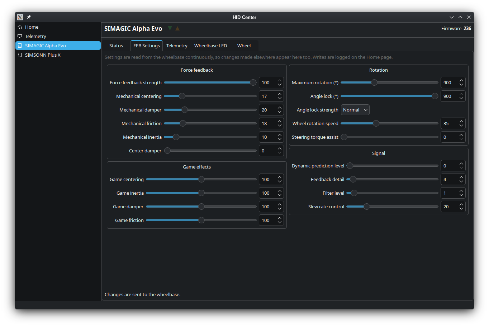

# HID Center

A Qt desktop application for configuring USB HID sim-racing hardware: force-feedback
settings on a direct-drive wheelbase, response curves on pedals, and so on.

It also picks up telemetry from running sims.

> **Note:** a telemetry plugin for Le Mans Ultimate (LMU) is coming soon.



## Supported devices

| Device | VID:PID |
| --- | --- |
| SIMAGIC Alpha Evo | `3670:0500` |
| SIMAGIC Alpha Evo | `3670:0501` |
| SIMAGIC Alpha Evo | `3670:0502` |
| SIMSONN Plus X | `ddfd:6011` |

## Building

Needs CMake ≥ 3.21, a C++20 compiler, Qt 6.2+ (Widgets) and, on Linux, `libudev`.

```sh
cmake -S . -B build -G Ninja
cmake --build build
./build/hid-center
```

## Device access

`/dev/hidraw*` is root-only by default, so install the udev rules or devices will be listed
but fail to open:

```sh
sudo cp udev/70-hid-center.rules /etc/udev/rules.d/
sudo udevadm control --reload-rules
sudo udevadm trigger
```

## Disclaimer

HID Center is an independent project. It is not affiliated with, endorsed by or supported by
SIMAGIC, SIMSONN or any other hardware maker. Product and company names are trademarks of their
owners and are used only to say which devices the application works with.

How these devices talk was worked out by watching their USB traffic and trying things on real
hardware, not from the makers' own software or documentation. Some of it is guesswork. Writing
settings to a device can change how it behaves, and the application is used entirely at your own
risk; see the warranty disclaimer in the license.

## Support

HID Center was made to solve the author's own needs, and is shared in case it is useful to others.
There is no promise of support: issues and pull requests are welcome, but they may go unanswered,
and the application may not suit your hardware or setup.

## AI-assisted development

Most of this project was written with the help of AI coding assistants, guided and reviewed by
the author, and tested on real hardware. Treat it accordingly, and please report anything that
looks wrong.

## License

HID Center is free software, licensed under the
[GNU General Public License, version 3 or later](LICENSE). It links against Qt, used under the
terms of the LGPL v3, and against `libudev` (LGPL v2.1 or later), both dynamically.
